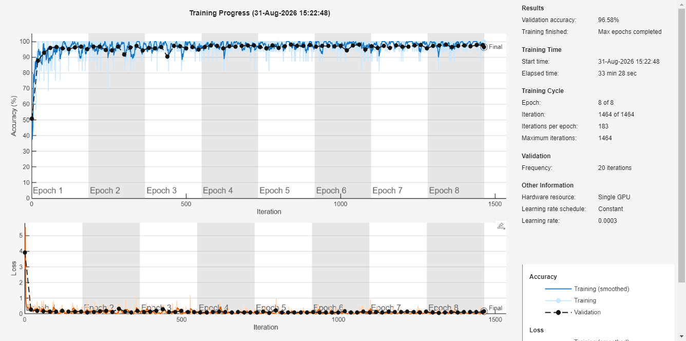

# DR-Ishti: Explainable AI for Diabetic Retinopathy Screening

[](https://matlab.mathworks.com/open/github/v1?repo=Nitin-Shukla-eng/DR-Ishti-P&file=run_demo.m)

A MATLAB prototype for screening diabetic retinopathy (DR) from retinal fundus images. It checks image quality, enhances the image, classifies it as DR or No DR, highlights the regions that drove the decision, and generates a short report. Built for the Smart India Hackathon, problem statement 26038: *Explainable AI for Diabetic Retinopathy Screening in Rural India*.

> **Disclaimer:** This is a research and educational prototype. It is not a medical device and must not be used for clinical diagnosis.



## Features

- Image quality assessment and adaptive enhancement
- Binary DR / No-DR classification using a trained deep learning model
- Explainability overlay showing which regions influenced the prediction
- Automatic screening report
- Simulink resource model for a district-level screening workflow
- Simple dashboard for uploading a fundus image and viewing the result

## Try it in your browser (no installation)

1. Click the **Open in MATLAB Online** button above.
2. Sign in with a free MathWorks account.
3. Open `run_demo.m` and click **Run**.
4. In the dashboard, upload an image from the `sample_data/` folder.

MATLAB Online availability of the required toolboxes depends on your MathWorks licence.

## Run it locally

1. Install MATLAB with the toolboxes listed below.
2. Clone the repository:
   ```bash
   git clone https://github.com/Nitin-Shukla-eng/DR-Ishti-P.git
   cd DR-Ishti-P
   ```
3. Open MATLAB in the cloned folder and run:
   ```matlab
   run_demo
   ```
4. Upload a fundus image from `sample_data/` (or your own) in the dashboard.

## Requirements

- MATLAB R20XX or later (replace with your version; run `ver` in MATLAB to check)
- Image Processing Toolbox
- Computer Vision Toolbox
- Deep Learning Toolbox
- Statistics and Machine Learning Toolbox
- Simulink (only for the workflow simulation)

## Repository structure

```
DR-Ishti-P/
├── app/              Dashboard (DRScreeningApp.m)
├── src/              Pipeline: quality check, classifier, explainability, reporting
├── models/           Trained classifier (dr_classifier_binary.mat)
├── simulink/         Screening workflow model builder
├── reports/          Sample test report
├── sample_data/      A few example fundus images for testing
├── run_demo.m        Launches the dashboard
└── DR-Ishti.prj      MATLAB project file
```

## Dataset and retraining

The model was trained on the [APTOS 2019 Blindness Detection](https://www.kaggle.com/c/aptos2019-blindness-detection) dataset. The dataset is **not included** in this repository because of its size and licence terms. To retrain:

1. Download APTOS 2019 from Kaggle.
2. Place it in `data/APTOS/raw/`.
3. Run `src/trainDRClassifier.m`.

## Results

See `reports/test_report.png` and the figure above for the evaluation on the test set.

## Limitations

- Binary classification only (DR vs No DR), not full ICDR 0 to 4 grading.
- Trained on a single public dataset, so performance on other cameras and populations is untested.
- Built as a one-day prototype and not clinically validated.

## Author

Nitin Kumar Shukla, B.Tech ECE, USICT, GGSIPU.

## Acknowledgements

APTOS 2019 dataset (Asia Pacific Tele-Ophthalmology Society) and MathWorks tools used for development.
